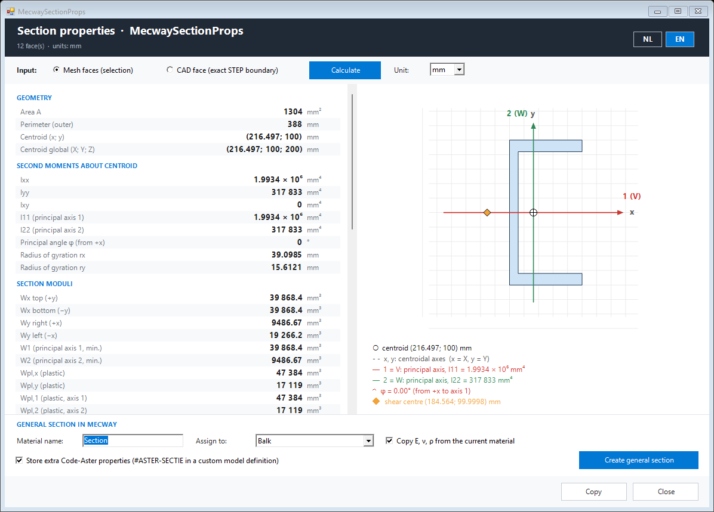

# MecwaySectionProps

Cross-section properties of a flat face in [Mecway](https://mecway.com), and a Mecway
*General section* made from them in one click.

Select the faces of a cross-section in Mecway (face selection), start the script, and get
area, centroid, second moments of area (also about the principal axes), elastic and
plastic section moduli, torsion constant J, warping constant Iw, shear centre and shear
areas, with a drawing of the section. The input is either the selected mesh faces or the
exact boundary of the CAD (STEP) face they lie on. Small gaps in the boundary are closed
automatically and reported.

*Create general section* makes a Mecway material with a general section (area, Iyy,
Izz, torsion constant, perimeter, stress recovery point). The characteristics Mecway has
no field for (shear coefficients, shear centre eccentricity, warping constant, ...) are
stored in the model as an `#ASTER-SECTIE` line, which
[MecwayAsterBridge](https://github.com/trednuK/MecwayAsterBridge) passes to Code-Aster.

It is the Mecway version of AreaPropsForAlibre, without extra Python packages: the
analysis (a quadratic triangle mesh of the section and the finite element formulation of
Pilkey, as the package sectionproperties uses) runs in the Python that comes with
Code-Aster (numpy and scipy).

## Requirements

- Mecway 34 (Windows), with its scripting (IronPython 2.7.9) and Windows Forms.
- Code-Aster for Windows (e.g. 17.4 in `%LOCALAPPDATA%\code_aster`): only its Python
  with numpy and scipy is used; it is found automatically.

Nothing else needs to be installed.

## Installation

1. Download this repository (*Code* > *Download ZIP*, unzip) or clone it, e.g. to
   `Documents\GitHub\MecwaySectionProps`.
2. In Mecway: *Tools* > *Scripts...* > *New*, and choose `Scripts\MecwaySectionProps.py`.
   It then appears in the *Tools* menu.

## Use

1. In Mecway choose *Edit* > *Select faces* (and, handy, *Edit* > *Edge detecting
   selection*: one click selects a whole flat face) and select the faces of the section.
2. *Tools* > *MecwaySectionProps*. The window stays open next to Mecway.
3. Choose *Mesh faces* or *CAD face*, click **Calculate**.
4. Optionally **Create general section** (material name, component, copy E/ν/ρ, store the
   extra Code-Aster properties).

Full documentation: [English](docs/en/MecwaySectionProps.md),
[Nederlands](docs/MecwaySectionProps.md).

## Accuracy

Checked against sectionproperties (13 sections: geometric properties exact, J, Iw and
shear areas within 1.6e-4) and against Code-Aster's own `MACR_CARA_POUTRE` (AY, AZ, EY,
EZ, JG, IYR2, IZR2 within 1e-6); GUI-tested in Mecway 34. Details in the documentation
§6.

## Development

- `Scripts/`: `MecwaySectionProps.py` (entry point), `section_gui.py`, `section_mecway.py`,
  `section_utils.py` (IronPython 2.7, inside Mecway); `section_analysis.py`,
  `section_mesh.py`, `section_fem.py` (CPython 3 with numpy/scipy, started as a
  process); `section_step.py` (STEP reader, both).
- Tests: `python tests/test_section_mecway.py`, `python tests/test_section_step.py`,
  `python tests/test_section_analysis.py` (reruns itself with Code-Aster's Python), and
  in Mecway's IronPython without Mecway: `tools/run_ipy.ps1 -Script <test>`.
  `tests/section_aster_check.py` compares with `MACR_CARA_POUTRE` (runs Code-Aster).
- Conventions: [AGENTS.md](AGENTS.md).

## License

[Mozilla Public License 2.0](LICENSE). Mecway is a product of Mecway Ltd; this project
is not affiliated with Mecway Ltd or EDF (Code-Aster).
