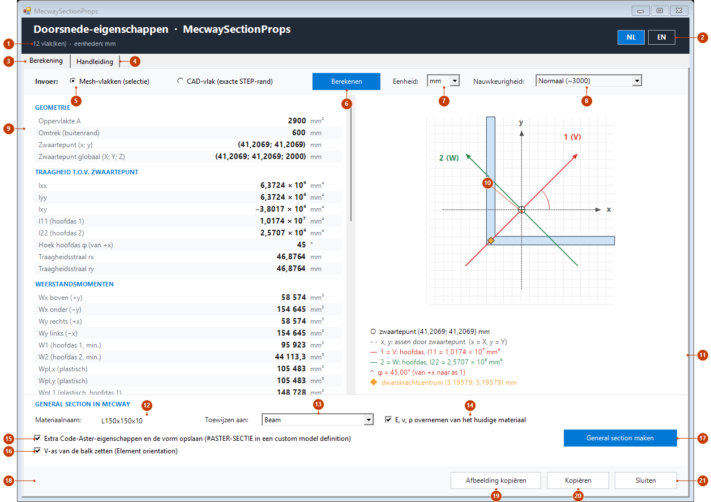
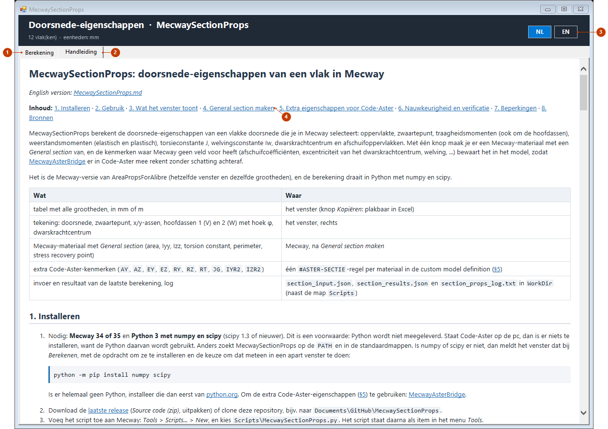

# MecwaySectionProps: doorsnede-eigenschappen van een vlak in Mecway

*English version: [MecwaySectionProps.md](en/MecwaySectionProps.md)*

**Inhoud:** [1. Installeren](#1-installeren) · [2. Gebruik](#2-gebruik) ·
[3. Wat het venster toont](#3-wat-het-venster-toont) ·
[4. General section maken](#4-general-section-maken) ·
[5. Extra eigenschappen voor Code-Aster](#5-extra-eigenschappen-voor-code-aster-aster-sectie) ·
[6. Nauwkeurigheid en verificatie](#6-nauwkeurigheid-en-verificatie) ·
[7. Beperkingen](#7-beperkingen) · [8. Bronnen](#8-bronnen)

MecwaySectionProps berekent de doorsnede-eigenschappen van een vlakke doorsnede die je in
Mecway selecteert: oppervlakte, zwaartepunt, traagheidsmomenten (ook om de hoofdassen),
weerstandsmomenten (elastisch en plastisch), torsieconstante J, welvingsconstante Iw,
dwarskrachtcentrum en afschuifoppervlakken. Met één knop maak je er een Mecway-materiaal
met een *General section* van, en de kenmerken waar Mecway geen veld voor heeft
(afschuifcoëfficiënten, excentriciteit van het dwarskrachtcentrum, welving, ...) bewaart
het in het model, zodat [MecwayAsterBridge](https://github.com/trednuK/MecwayAsterBridge) er in Code-Aster mee rekent
zonder schatting achteraf.

Het is de Mecway-versie van AreaPropsForAlibre (hetzelfde venster en dezelfde grootheden),
en de berekening draait in Python met numpy en scipy.

| Wat | Waar |
|---|---|
| tabel met alle grootheden, in mm of m | het venster (knop *Kopiëren*: plakbaar in Excel) |
| tekening: doorsnede, zwaartepunt, x/y-assen, hoofdassen 1 (V) en 2 (W) met hoek φ, dwarskrachtcentrum | het venster, rechts |
| Mecway-materiaal met *General section* (area, Iyy, Izz, torsion constant, perimeter, stress recovery point) | Mecway, na *General section maken* |
| extra Code-Aster-kenmerken (`AY`, `AZ`, `EY`, `EZ`, `RY`, `RZ`, `RT`, `JG`, `IYR2`, `IZR2`) | één `#ASTER-SECTIE`-regel per materiaal in de custom model definition (§5) |
| invoer en resultaat van de laatste berekening, log | `section_input.json`, `section_results.json` en `section_props_log.txt` in `WorkDir` (naast de map `Scripts`) |

## 1. Installeren

1. Nodig: **Mecway 34 of 35** en **Python 3 met numpy en scipy** (scipy 1.3 of nieuwer).
   Dit is een voorwaarde: Python wordt niet meegeleverd. Staat Code-Aster op de pc, dan
   is er niets te installeren, want de Python daarvan wordt gebruikt. Anders zoekt
   MecwaySectionProps op de `PATH` en in de standaardmappen. Is numpy of scipy er niet,
   dan meldt het venster dat bij *Berekenen*, met de opdracht om ze te installeren en
   de keuze om dat meteen in een apart venster te doen:

   ```bash
   python -m pip install numpy scipy
   ```

   Is er helemaal geen Python, installeer die dan eerst van
   [python.org](https://www.python.org). Om de extra Code-Aster-eigenschappen (§5) te
   gebruiken: [MecwayAsterBridge](https://github.com/trednuK/MecwayAsterBridge).
2. Download de [laatste release](https://github.com/trednuK/MecwaySectionProps/releases/latest) (*Source code (zip)*,
   uitpakken) of clone deze repository, bijv. naar `Documents\GitHub\MecwaySectionProps`.
3. Voeg het script toe aan Mecway: *Tools* > *Scripts...* > *New*, en kies
   `Scripts\MecwaySectionProps.py`. Het script staat daarna als item in het menu *Tools*.

Instellingen (niet nodig in het normale geval) staan in `Scripts\section_settings.json`
(wordt aangemaakt als je in het venster de taal kiest; niet in git):

| Sleutel | Betekenis | Standaard |
|---|---|---|
| `language` | `nl` of `en` (de knoppen NL/EN in het venster) | de taal van Windows |
| `accuracy` | `coarse`, `normal`, `fine` of `very_fine` (de keuze *Nauwkeurigheid*) | `normal` |
| `work_dir` | werkmap voor invoer, resultaat en log | `WorkDir` naast `Scripts` |
| `python` | pad naar een `python.exe` met numpy en scipy (ook de oude naam `aster_python` werkt) | gezocht: Code-Aster, `PATH`, standaardmappen |
| `python_found` | de Python die het zoeken vond (schrijft het programma zelf) | - |

## 2. Gebruik

1. Selecteer in Mecway, in de **vlakselectie** (*Select faces*), de vlakken van de
   doorsnede: bijvoorbeeld de eindvlakken van een geëxtrudeerd profiel of het
   snijvlak van een volume. Alle vlakken moeten in één plat vlak liggen.
   Heeft het model nog geen mesh, zie dan §2.1.
2. Start *Tools* > `MecwaySectionProps`. Het venster blijft open naast Mecway: je kunt
   een andere selectie maken en opnieuw op **Berekenen** klikken. Een tweede start van
   het script haalt het open venster naar voren.
3. Kies de invoer:
   - **Mesh-vlakken (selectie)**: de rand van de geselecteerde mesh-vlakken. Randen die
     twee geselecteerde vlakken delen vallen weg; wat overblijft is de buitenrand en de
     rand van gaten. Bij kwadratische elementen (tet10, hex20, ...) volgt de rand de
     parabool door de middenknoop (gebogen randen). Werkt voor elk model, ook zonder
     CAD.
   - **CAD-vlak (exacte STEP-rand)**: alleen voor een component die Mecway uit een
     STEP-geometrie heeft gemesht (*Geometry* in het model). De tool zoekt in het
     STEP-bestand het vlakke CAD-vlak waar de geselecteerde mesh-vlakken op liggen en
     rekent met de **exacte** rand (lijnen, cirkels, ellipsen, B-splines), los van de
     meshfijnheid. Selecteer één of meer mesh-vlakken op het CAD-vlak; het hele CAD-vlak
     telt mee. Meerdere aangrenzende CAD-vlakken in hetzelfde vlak worden samengevoegd.
     Het STEP-bestand komt uit de opgeslagen `.liml`. Is het model niet opgeslagen, dan
     vraagt het venster welk bestand het is en onthoudt dat zolang het open is. Bij
     *Annuleren*, of als er op die plek geen STEP-vlak is, wordt de rand van de mesh
     gebruikt en staat dat bij de resultaten. Ook assemblies werken: het vlak wordt
     gezocht op de plaats die Mecway toont.
4. Kies eventueel de **Nauwkeurigheid** (de fijnheid van het mesh waarmee de doorsnede
   wordt doorgerekend): *Grof* (±1000 kwadratische driehoeken), *Normaal* (±3000,
   standaard), *Fijn* (±10000) of *Zeer fijn* (±30000); in dunne wanden ook meer
   elementen over de dikte (2, 3, 4 of 6 rijen). De keuze wordt onthouden en geldt bij de
   volgende klik op *Berekenen*; de gebruikte fijnheid staat onder de tabel.
5. Klik op **Berekenen**. De berekening (het mesh en de eindige-elementenberekening voor
   torsie en afschuiving) duurt enkele seconden (*Zeer fijn* iets langer); de statusregel
   telt mee.
6. Lees de tabel en de tekening; *Kopiëren* zet de tabel op het klembord
   (tab-gescheiden, decimaalteken van Windows), *Afbeelding kopiëren* alleen de tekening
   (tweemaal zo scherp als op het scherm). *NL*/*EN* rechtsboven wisselt de taal,
   *Eenheid* tussen mm en m.

**Kleine openingen in de rand** worden automatisch gerepareerd, zodat de berekening
toch kan; elke reparatie staat als opmerking onder de tabel:

- *Mesh-vlakken*: knopen op (vrijwel) dezelfde plek (binnen 1e-4 van de afmeting, bijv.
  een geïmporteerd mesh met dubbele knopen) worden één knoop; een rand waar een knoop
  van een ander vlak op ligt (T-aansluiting van een niet-conform mesh) wordt daar
  gesplitst; losse rand-einden worden met een rechte lijn verbonden met het dichtstbijzijnde
  losse einde.
- *CAD-vlak*: randen waarvan de eindpunten niet precies op elkaar aansluiten worden met
  een rechte lijn verbonden.
- Beide: liggen de vlakken niet precies in één plat vlak (een mesh of CAD-model met een
  kleine afwijking), dan worden ze op het best passende vlak geprojecteerd
  ("rechtgetrokken"); de grootste afwijking staat onder de tabel. Pas bij een afwijking
  van meer dan 1 % van de afmeting (een gebogen selectie) stopt de berekening.
- Een opening wordt alleen gesloten tot 2 % van de afmeting van de doorsnede; is hij
  groter, dan stopt de berekening met de plaats van de opening. Een echte sleuf (met
  eigen randen) is geen losse rand en blijft dus open.

### 2.1 STEP zonder mesh

Mecway geeft een surface die je in de *Geometry*-weergave selecteert niet door aan
scripts, ook niet als het model is opgeslagen; de API kent alleen mesh-vlakken. Er wordt
geen mesh gemaakt: dat duurt te lang en is niet nodig. Het gaat zo:

1. Klik op **Berekenen** in een model zonder elementen. Het script leest de STEP en zet
   alle vlakke vlakken, op hun plaats in de assembly, als tijdelijke vlakjes in de
   component `SectionProps_tijdelijk` (enkele seconden). Is het model niet opgeslagen,
   dan vraagt het venster eerst om het STEP-bestand.
2. Toon het model in Mecway, kies *Select faces* (toets `f`) en klik op het vlak van de
   doorsnede. Selecteren in de elementselectie kan ook.
3. Klik weer op **Berekenen**. De rand komt exact uit de STEP; op de vlakjes wordt
   niets gerekend.

Na de berekening verwijdert het script alles wat het heeft toegevoegd; dat gebeurt ook
als je het venster eerder sluit. Mislukt de berekening, dan blijven de vlakjes staan,
zodat je een ander vlak kunt kiezen. Blijft de component toch achter (Mecway gestopt),
dan ruimt de volgende start van het venster hem op; sla het model niet op terwijl de
vlakjes er staan. Een model met een eigen mesh wordt nooit aangeraakt.

## 3. Wat het venster toont

Het venster heeft twee tabbladen: *Berekening* (§3.1) en *Handleiding* (§3.2). De kop met
de taalknoppen staat boven allebei.

### 3.1 Het tabblad Berekening



| Nr | Onderdeel | Uitleg |
|---|---|---|
| 1 | Kop | Wat er berekend is (het aantal vlakken of het CAD-vlak) en de eenheden. |
| 2 | NL / EN | De taal van het venster en van de handleiding; wordt onthouden. |
| 3 | Berekening | Dit tabblad. |
| 4 | Handleiding | De handleiding in het venster (§3.2). Wisselen van tabblad stopt niets. |
| 5 | Invoer | *Mesh-vlakken*: de vlakken die je in Mecway hebt geselecteerd. *CAD-vlak*: de exacte rand uit het STEP-bestand (§2.1). |
| 6 | Berekenen | Leest de selectie en start de berekening in Python. |
| 7 | Eenheid | mm of m, voor de tabel, de tekening en *Kopiëren*. |
| 8 | Nauwkeurigheid | Hoe fijn de doorsnede wordt verdeeld; geldt vanaf de volgende berekening (§6). |
| 9 | Tabel | Alle grootheden per groep (tabel hieronder); scroll voor de rest. |
| 10 | Tekening | De doorsnede met zwaartepunt, x/y-assen, hoofdassen 1 (V) en 2 (W), hoek φ en dwarskrachtcentrum. |
| 11 | Legenda | De waarden bij de tekening. |
| 12 | Materiaalnaam | De naam van het nieuwe Mecway-materiaal (§4). |
| 13 | Toewijzen aan | De balkcomponent die het materiaal krijgt, of geen. |
| 14 | E, ν, ρ overnemen | Neemt de elastische gegevens en de dichtheid over van het huidige materiaal van die component (§4). |
| 15 | Extra Code-Aster-eigenschappen en de vorm opslaan | De `#ASTER-SECTIE`-regel, de omtrek en de richting in het model (§5). |
| 16 | V-as van de balk zetten | Geeft de balken de juiste *Element orientation* (§4). |
| 17 | General section maken | Maakt het materiaal en wijst het toe (§4). |
| 18 | Statusregel | Meldingen en fouten van de laatste actie. |
| 19 | Afbeelding kopiëren | De tekening naar het klembord, scherper dan op het scherm. |
| 20 | Kopiëren | De tabel naar het klembord, plakbaar in Excel. |
| 21 | Sluiten | Sluit het venster; tijdelijke vlakjes van een STEP-model verdwijnen. |

**Assen.** De doorsnede wordt bekeken van buiten het volume (zoals AreaPropsForAlibre):
de normaal n wijst uit de elementen, y is de globale Y-as geprojecteerd op het vlak (of
−Z/+Z bij een vlak loodrecht op Y) en x = y × n. De oorsprong is die van het model, dus het
zwaartepunt staat in modelcoördinaten; daaronder ook globaal (X; Y; Z).

| Groep | Grootheden |
|---|---|
| Geometrie | A, omtrek van de buitenrand, zwaartepunt |
| Traagheid | Ixx, Iyy, Ixy om het zwaartepunt; hoofdtraagheden I11 ≥ I22; hoek φ van +x naar hoofdas 1 (tegen de klok in); traagheidsstralen |
| Weerstandsmomenten | elastisch Wx (boven/onder), Wy (rechts/links), W1, W2 (kleinste om de hoofdassen); plastisch Wpl,x, Wpl,y, Wpl,1, Wpl,2 |
| Torsie, welving, afschuiving | J (Saint-Venant), Iw (om het dwarskrachtcentrum), dwarskrachtcentrum (x; y), afschuifoppervlakken As,1 en As,2 (langs de hoofdassen) |
| Mecway General section | de waarden die *General section maken* invult, en de richtingen U, V, W (§4) |
| Code-Aster GENERALE | `AY`, `AZ`, `EY`, `EZ`, `RY`, `RZ`, `RT`, `JG`, `IYR2`, `IZR2` (§5) |

Torsie, welving en afschuiving bestaan alleen voor een samenhangende doorsnede; bestaat
de selectie uit losse delen, dan staat de reden onder de tabel en kan er geen *General
section* van worden gemaakt.

### 3.2 De handleiding in het venster



| Nr | Onderdeel | Uitleg |
|---|---|---|
| 1 | Berekening | Terug naar het rekenen; de resultaten blijven staan. |
| 2 | Handleiding | Deze tekst in de gekozen taal, met de afbeeldingen. Hij laadt pas als je het tabblad opent. |
| 3 | NL / EN | Wisselt de taal, ook van de handleiding. |
| 4 | Inhoud | Links naar de hoofdstukken. Ook een verwijzing als §4 in de tekst is een link. |

Een link naar een website opent in je eigen browser; de link naar de Engelse versie wisselt
de taal van het venster. De handleiding komt uit `docs/` naast de map `Scripts`; zonder
ingebouwde browser toont het tabblad de platte tekst.

## 4. General section maken

Onderaan het venster:

- **Materiaalnaam**: de naam van het nieuwe Mecway-materiaal (bestaat hij al, dan maakt
  Mecway er `naam(2)` van).
- **Toewijzen aan**: een balkcomponent (line2/line3) die het materiaal krijgt, of geen.
- **E, ν, ρ overnemen**: neemt het isotrope elastische materiaal (E, ν, α) en de
  dichtheid over van het huidige materiaal van die component, zodat alleen de doorsnede
  verandert.
- **Extra Code-Aster-eigenschappen en de vorm opslaan**: zet de `#ASTER-SECTIE`-regel en de
  omtrek in het model (§5), als een extra *custom model definition* onder *CCX* in de boom (de tool importeert
  daarvoor een klein `.liml`-bestand; er is geen Mecway-API voor dat tekstveld). Het model
  wordt niet opgeslagen of heropend; sla het zelf op (MecwayAsterBridge doet dat ook bij
  elke run). Klik eenmaal in de boom als het nieuwe materiaal (onder *Unused
  Materials*) of de *custom model definition* nog niet zichtbaar is.
- **V-as van de balk zetten**: geeft de balken van de component de juiste *Element
  orientation* (zie hieronder).

Het materiaal krijgt een *General section* met:

| Mecway | Waarde |
|---|---|
| Area | A |
| Iyy (om V) | I11 |
| Izz (om W) | I22 |
| Torsion constant | J |
| Perimeter | omtrek van de buitenrand |
| Stress recovery point (V; W) | het randpunt het verst van het zwaartepunt, in hoofdassen |

**Oriëntatie van de balk.** Mecway's *General section* kent alleen hoofdtraagheden; de
balk moet dus zo gedraaid zijn dat zijn V-as langs hoofdas 1 ligt. Anders kloppen niet
alleen de getekende stand, maar ook de stijfheid en de spanningen. Mecway's U-as loopt
langs de balk (knoop 1 → 2) en W = U × V; dat is hetzelfde als x, y, z van Code-Aster.

Met **V-as van de balk zetten** (standaard aan) regelt de tool dit bij het toewijzen aan
een component:

| Situatie | Wat er gebeurt |
|---|---|
| Balken langs de normaal n | *Element orientation* met de V-vector op een elementselectie `SECTION_V_<materiaal>`. Geen kaart als Mecway's standaard-V al klopt, of precies tegengesteld is bij een puntsymmetrische doorsnede (rechthoek, I, Z: `EY`, `EZ`, `IYR2` en `IZR2` nul). In dat laatste geval houden de balken Mecway's standaard-V en gelden de regels van paragraaf 5 voor die V (-as 1): omtrek en recovery point 180° gedraaid, de V-as in `SECTIE-RICHTING` die van de balken. Een tegengestelde V keert ook W om en draait de doorsnede dus 180°: bij elke andere doorsnede, bijvoorbeeld een T, komt de kaart er wel |
| Balken tegen n in | Hetzelfde, en de gegevens worden in W gespiegeld opgeslagen (`EZ`, `IYR2`, recovery point, omtrek) |
| Beide richtingen door elkaar | De meerderheid telt; een melding als de doorsnede niet symmetrisch is om V, want de rest ziet hem gespiegeld. Een puntsymmetrische doorsnede krijgt hier ook de kaart, omdat Mecway's standaard-V met de balkrichting omkeert |
| Balken meer dan 1° schuin op n | Niets gezet, een melding met de V-vector |
| Eigen oriëntatie op de balken | Niets gezet, een melding: Mecway rekent niet met twee oriëntaties op één element |

De tool kan een eigen oriëntatie alleen in het **opgeslagen** model zien, omdat de API
die niet kan lezen. Wijzigingen die nog niet zijn opgeslagen ziet hij niet; bij een model
zonder bestand staat dat in de melding. Wijs je de doorsnede opnieuw toe, dan gaan de
elementen uit de oude selectie; die blijft leeg in het model staan, met zijn kaart, want
de API kan een kaart niet verwijderen. Mag via het vinkje niets worden gezet en staat de
balk meer dan 1° verkeerd, dan meldt de tool dat met de V-vector. Dan geef je zelf
(*Loads & Constraints* > *Element orientation*, of *Element properties*) als V-vector de
richting uit de tabel (*V-vector (as 1)*). Zonder melding is dat niet nodig, ook niet bij een
puntsymmetrische doorsnede op Mecway's standaard-V: de regels gelden dan voor die V. Of *Ongedaan maken* deze stappen terugdraait,
is niet getest. Getest op Mecway 35; op 34 niet.

De tool verschuift geen knopen. De balklijn hoort
op het zwaartepunt (*Zwaartepunt globaal* in de tabel), anders staat de getekende
doorsnede ernaast.

**Open profiel in Code-Aster: kies `POU_D_TG`.** Gemeten op een open profiel met het
dwarskrachtcentrum 82 mm van het zwaartepunt, ingeklemd onder eigen gewicht, tegen een
volumemodel: `POU_D_TG` volgt de buiging en de wringing binnen 1,2%. `POU_D_E` krijgt wel
`EY` en `EZ` maar geen `JG`, en geeft een 5,6 keer te grote wringing. Mecway's eigen balk
neemt de wringing door die afstand niet mee (Mecway-handleiding, *Beams*).

## 5. Extra eigenschappen voor Code-Aster (`#ASTER-SECTIE`)

De regels hieronder gaan samen in één *custom model definition*. De laatste is
`** SECTIE-RICHTING <materiaal>: V=vx vy vz, U=ux uy uz`: de V-as die de balk moet hebben
en de balkrichting waarvoor de gegevens gelden, als globale eenheidsvectoren. Dat is hoofdas 1,
of -as 1 als een puntsymmetrische doorsnede zonder kaart Mecway's standaard-V houdt (paragraaf 4);
de andere regels gelden dan ook voor die V. Met die
regel waarschuwt MecwayAsterBridge als een balk later niet meer past, bijvoorbeeld na
een andere oriëntatie.

Code-Aster's `AFFE_CARA_ELEM` (`SECTION='GENERALE'`) kent meer kenmerken dan Mecway's
*General section* (EDF R&D, 2021a §9.4.3). De tool schrijft ze in de custom model
definition (*CCX* > *Custom model definition*; CCX leest `**`-regels als commentaar):

```
** ASTER-SECTIE Profiel: A=0.0018, IY=5.4e-07, IZ=1.35e-07, JX=..., AY=1.2, AZ=1.2, EY=0, EZ=-0.004, RY=0.03, RZ=0.015, RT=..., JG=..., IYR2=..., IZR2=...
```

Alle waarden in SI (m, m², m⁴, m⁶), lokaal y = V (hoofdas 1, of -as 1 zoals hierboven), z = W
(hoofdas 2):

| Sleutel | Betekenis | Gebruik door MecwayAsterBridge |
|---|---|---|
| `A`, `IY`, `IZ`, `JX` | kopie van de *General section* | controle: wijkt het materiaal af (later in Mecway aangepast), dan negeert MecwayAsterBridge de regel met een WARNING |
| `AY`, `AZ` | afschuifcoëfficiënt A / A' in y en z (rechthoek 1,2) | alleen bij Timoshenko-balken (`POU_D_T`, `POU_D_T_GD`), in plaats van de schatting of 1,0 |
| `EY`, `EZ` | vector van het dwarskrachtcentrum C naar het zwaartepunt G in y en z (CG, zoals `MACR_CARA_POUTRE`; nagelopen met Code-Aster 17.4) | elke balk (`POU_D_E`, `POU_D_T`, `POU_D_T_GD`): koppeling van buiging en torsie (EDF R&D, 2019 §5.1) |
| `RY`, `RZ` | grootste afstand tot het zwaartepunt in y en z | elke balk; alleen voor spanningen (EDF R&D, 2021a §9.3) |
| `RT` | torsiestraal: J · τmax / Mt | elke balk; alleen voor spanningen |
| `JG` | welvingsconstante | gebruikt door balken `POU_D_TG` in MecwayAsterBridge; andere balken negeren hem |
| `IYR2`, `IZR2` | ∫ z(y² + z²) dA en ∫ y(y² + z²) dA om het zwaartepunt (gelijk aan `MACR_CARA_POUTRE`) | gebruikt door balken `POU_D_TG` in MecwayAsterBridge, voor de geometrische stijfheid (EDF R&D, 2020) |

- Elke keer *General section maken* voegt een *custom model definition* toe met de regels
  van die doorsnede (`#ASTER-SECTIE`, `SECTIE-VORM`, `SECTIE-RICHTING`). MecwayAsterBridge
  leest ze allemaal, in volgorde; heeft een materiaal er meer, dan telt van elke soort de
  nieuwste. Oude regels mag je verwijderen (rechtsklik op het item in de boom).
- Hernoem je het materiaal in Mecway, pas dan de naam in de regel aan (anders: WARNING
  "geen materiaal met deze naam").
- De log van een run van MecwayAsterBridge toont wat er is overgenomen:
  `INFO: Material 'Profiel': #ASTER-SECTIE adds EY=..., EZ=..., ...`.
- Mecway zelf gebruikt alleen de *General section* en houdt geen rekening met het
  dwarskrachtcentrum (Mecway-handleiding §7.5, Mecway Ltd., 2026); de resultaten van
  Code-Aster wijken bij een asymmetrische doorsnede dus bewust af van Mecway.

### De vorm van de doorsnede

Mecway tekent geen vorm bij een general section. Daarom gaat de omtrek mee in dezelfde
custom model definition, voor MecwayAsterBridge, die hem op de balken kan tekenen:

```
** SECTIE-VORM Profiel: N=6, A=0.0018
** SECTIE-VORM Profiel: P=-0.024 -0.014 0.036 -0.014 0.036 -0.008 -0.018 -0.008 -0.018 0.026 -0.024 0.026
```

`N` geeft het aantal punten per lus (spatie tussen de lussen), `A` de oppervlakte en de
`P`-regels de punten `V W`, achter elkaar: meters, hoofdassen om het zwaartepunt. De omtrek
is vereenvoudigd tot 0,2% van de grootte van de doorsnede (hooguit 40 punten per lus, 120
in totaal), dus een *General section maken* voegt een handvol regels toe. De regels
hierboven gelden ook hier: de laatste regels van een materiaal tellen, en oude definities
mag je verwijderen. MecwayAsterBridge vergelijkt `A` met het materiaal en gebruikt een omtrek
die er niet meer bij hoort niet. Mecway en CCX negeren deze regels. Het tonen van de doorsnede
doet MecwayAsterBridge vanaf V2026.7 (knoppen *Doorsnede tonen* en *Doorsnede in resultaten*), niet dit
hulpmiddel.

## 6. Nauwkeurigheid en verificatie

De doorsnede wordt opnieuw gemesht met kwadratische driehoeken (tri6, standaard ±3000;
in dunne wanden zo fijn dat er minstens drie elementen over de dikte komen; de keuze
*Nauwkeurigheid* in §2 verandert beide). Oppervlakte,
zwaartepunt, traagheden en weerstandsmomenten volgen exact uit de driehoeken; torsie,
welving en afschuiving uit een eindige-elementenberekening (Pilkey, 2002), dezelfde
formulering als het Python-pakket sectionproperties dat AreaPropsForAlibre gebruikt.
Afschuiving met ν = 0, zoals `MACR_CARA_POUTRE` (rechthoek: AY = 1,2).

Vergeleken (`tests/test_section_analysis.py`, 23 okt 2026) met sectionproperties voor
13 doorsneden (rechthoek, cirkel, buis, I met en zonder afrondingen, U, ongelijkzijdige
hoek, T, Z, plaat met gaten, dunne koker, dunne open U met t = 1/100, twee losse delen) en
met `MACR_CARA_POUTRE` van Code-Aster 17.4 op hetzelfde mesh (rechthoek, U, hoek, Z):

| Grootheid | Grootste verschil |
|---|---|
| A, zwaartepunt, Ixx, Iyy, Ixy, I11, I22, φ, elastische W | ≤ 1e-12 |
| plastische W | ≤ 1e-8 |
| J, Iw, afschuifoppervlakken | ≤ 1,6e-4 (sectionproperties); J ≤ 6,8e-4 (Code-Aster) |
| dwarskrachtcentrum | ≤ 6e-6 × afmeting |
| `AY`, `AZ`, `EY`, `EZ`, `JG`, `IYR2`, `IZR2`, `RY`, `RZ` tegen Code-Aster | ≤ 1e-6 |
| `RT` tegen Code-Aster | rechthoek 4e-5; bij inspringende hoeken −3 % tot +17 % (de spanning is daar singulier; beide hangen van het mesh af) |

Rekentijd: 0,1–0,5 s voor de berekening zelf, plus het starten van Python (enkele
seconden). Het mesh van de *Mesh-vlakken*-route komt uit de rand van de selectie, niet uit
de Mecway-elementen; een grof Mecway-mesh beïnvloedt dus alleen de vorm van gebogen randen.

## 7. Beperkingen

- Alleen **vlakke** doorsneden: de geselecteerde vlakken moeten in één vlak liggen; een
  afwijking tot 1 % van de afmeting wordt rechtgetrokken (§2).
- *Mesh-vlakken*: de rand is zo nauwkeurig als het mesh. Een cirkel met lineaire
  elementen is een veelhoek; kwadratische elementen volgen een boog via de middenknoop
  (een grove boog van 45° per element mist 0,2 % van de oppervlakte). Gebruik voor
  gebogen randen liever *CAD-vlak* of een fijner mesh.
- *CAD-vlak*: alleen vlakke STEP-vlakken met lijnen, cirkels, ellipsen, polylijnen en
  (rationele) B-splines. Assemblies: plaatsingen via `ITEM_DEFINED_TRANSFORMATION`, ook
  genest, nagemeten aan Mecway 35; `MAPPED_ITEM` wordt niet ondersteund.
- Losse delen: geen J, Iw, dwarskrachtcentrum of afschuiving, en geen *General section*.
- Het venster werkt alleen in Mecway met Windows Forms en met Python 3 met numpy en scipy.
- Een surface die in de *Geometry*-weergave is geselecteerd is niet leesbaar (§2.1).
- Mecway 34 en 35 zijn beide getest, ook met een STEP-assembly (de vlakken komen uit het
  STEP-bestand zelf, dus Mecway hoeft de assembly niet te kunnen inlezen). De gratis
  versie van Mecway weigert scripts bij meer dan 1000 knopen; de tijdelijke vlakjes van
  een groter model zijn dan niet automatisch te verwijderen.

## 8. Bronnen

- EDF R&D (2019). *Éléments « exacts » de poutres (droites et courbes)*. Code_Aster
  documentatie R3.08.01.
- EDF R&D (2020). *Macro-commande MACR_CARA_POUTRE*. Code_Aster documentatie U4.42.02.
- EDF R&D (2021a). *Opérateur AFFE_CARA_ELEM*. Code_Aster documentatie U4.42.01.
- Mecway Ltd. (2026). *Mecway manual*, §7.5 Beam, §16.2 Scripts (met Mecway
  geïnstalleerd als `manual.pdf`).
- Pilkey, W. D. (2002). *Analysis and Design of Elastic Beams: Computational Methods*.
  Wiley.
