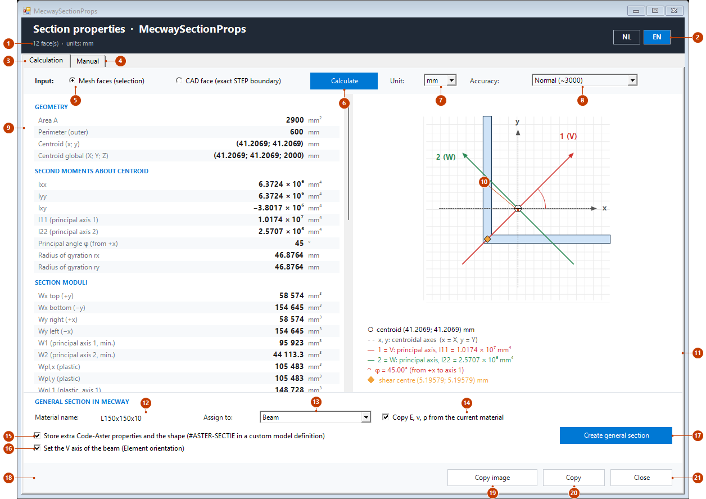
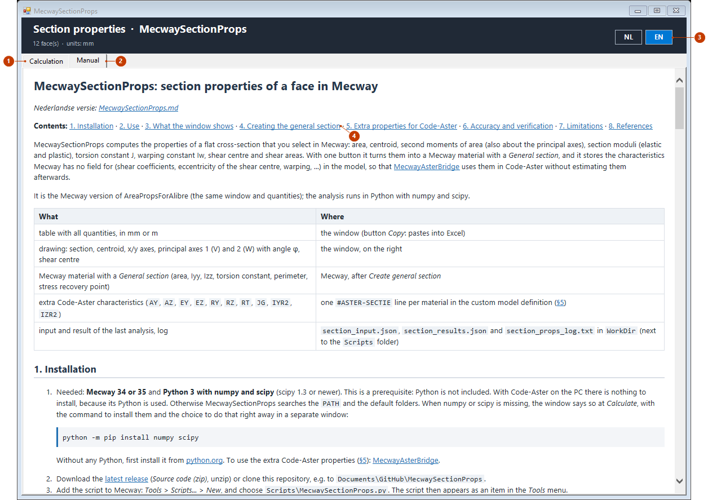

# MecwaySectionProps: section properties of a face in Mecway

*Nederlandse versie: [MecwaySectionProps.md](../MecwaySectionProps.md)*

**Contents:** [1. Installation](#1-installation) · [2. Use](#2-use) ·
[3. What the window shows](#3-what-the-window-shows) ·
[4. Creating the general section](#4-creating-the-general-section) ·
[5. Extra properties for Code-Aster](#5-extra-properties-for-code-aster-aster-sectie) ·
[6. Accuracy and verification](#6-accuracy-and-verification) ·
[7. Limitations](#7-limitations) · [8. References](#8-references)

MecwaySectionProps computes the properties of a flat cross-section that you select in
Mecway: area, centroid, second moments of area (also about the principal axes), section
moduli (elastic and plastic), torsion constant J, warping constant Iw, shear centre and
shear areas. With one button it turns them into a Mecway material with a *General
section*, and it stores the characteristics Mecway has no field for (shear coefficients,
eccentricity of the shear centre, warping, ...) in the model, so that
[MecwayAsterBridge](https://github.com/trednuK/MecwayAsterBridge) uses
them in Code-Aster without estimating them afterwards.

It is the Mecway version of AreaPropsForAlibre (the same window and quantities); the
analysis runs in Python with numpy and scipy.

| What | Where |
|---|---|
| table with all quantities, in mm or m | the window (button *Copy*: pastes into Excel) |
| drawing: section, centroid, x/y axes, principal axes 1 (V) and 2 (W) with angle φ, shear centre | the window, on the right |
| Mecway material with a *General section* (area, Iyy, Izz, torsion constant, perimeter, stress recovery point) | Mecway, after *Create general section* |
| extra Code-Aster characteristics (`AY`, `AZ`, `EY`, `EZ`, `RY`, `RZ`, `RT`, `JG`, `IYR2`, `IZR2`) | one `#ASTER-SECTIE` line per material in the custom model definition (§5) |
| input and result of the last analysis, log | `section_input.json`, `section_results.json` and `section_props_log.txt` in `WorkDir` (next to the `Scripts` folder) |

## 1. Installation

1. Needed: **Mecway 34 or 35** and **Python 3 with numpy and scipy** (scipy 1.3 or
   newer). This is a prerequisite: Python is not included. With Code-Aster on the PC
   there is nothing to install, because its Python is used. Otherwise MecwaySectionProps
   searches the `PATH` and the default folders. When numpy or scipy is missing, the
   window says so at *Calculate*, with the command to install them and the choice to do
   that right away in a separate window:

   ```bash
   python -m pip install numpy scipy
   ```

   Without any Python, first install it from [python.org](https://www.python.org). To
   use the extra Code-Aster properties (§5):
   [MecwayAsterBridge](https://github.com/trednuK/MecwayAsterBridge).
2. Download the [latest release](https://github.com/trednuK/MecwaySectionProps/releases/latest) (*Source code (zip)*, unzip)
   or clone this repository, e.g. to `Documents\GitHub\MecwaySectionProps`.
3. Add the script to Mecway: *Tools* > *Scripts...* > *New*, and choose
   `Scripts\MecwaySectionProps.py`. The script then appears as an item in the *Tools*
   menu.

Settings (not needed in the normal case) are in `Scripts\section_settings.json` (created
when you choose the language in the window; not in git):

| Key | Meaning | Default |
|---|---|---|
| `language` | `nl` or `en` (the NL/EN buttons of the window) | the Windows language |
| `accuracy` | `coarse`, `normal`, `fine` or `very_fine` (the *Accuracy* choice) | `normal` |
| `work_dir` | work folder for input, result and log | `WorkDir` next to `Scripts` |
| `python` | path of a `python.exe` with numpy and scipy (the old name `aster_python` also works) | searched: Code-Aster, `PATH`, default folders |
| `python_found` | the Python the search found (written by the program) | - |

## 2. Use

1. In Mecway, in **face selection** (*Select faces*), select the faces of the
   cross-section: for example the end faces of an extruded profile or the cut face of a
   solid. All faces must lie in one flat plane. If the model has no mesh yet, see §2.1.
2. Start *Tools* > `MecwaySectionProps`. The window stays open next to Mecway: you can
   make another selection and click **Calculate** again. Starting the script a second
   time brings the open window to the front.
3. Choose the input:
   - **Mesh faces (selection)**: the boundary of the selected mesh faces. Edges shared
     by two selected faces drop out; what remains is the outer boundary and the boundary
     of holes. With quadratic elements (tet10, hex20, ...) the boundary follows the
     parabola through the midside node (curved edges). Works for any model, also without
     CAD.
   - **CAD face (exact STEP boundary)**: only for a component Mecway meshed from a STEP
     geometry (*Geometry* in the model). The tool looks up, in the STEP file, the flat
     CAD face that the selected mesh faces lie on and uses its **exact** boundary (lines,
     circles, ellipses, B-splines), independent of the mesh density. Select one or more
     mesh faces on the CAD face; the whole CAD face counts. Several adjacent CAD faces in
     the same plane are merged. The STEP file comes from the saved `.liml`. If the model
     is not saved, the window asks which file it is and remembers that while it is open.
     With *Cancel*, or when there is no STEP face at that place, the boundary of the mesh
     is used and the results say so. Assemblies work too: the face is looked up at the
     position Mecway shows.
4. Optionally choose the **Accuracy** (the fineness of the mesh the section is analysed
   on): *Coarse* (about 1000 quadratic triangles), *Normal* (about 3000, default), *Fine*
   (about 10000) or *Very fine* (about 30000); in thin walls also more elements across
   the thickness (2, 3, 4 or 6 rows). The choice is remembered and applies at the next
   click on *Calculate*; the fineness used is shown under the table.
5. Click **Calculate**. The analysis (the mesh and the finite element analysis for
   torsion and shear) takes a few seconds (*Very fine* a bit longer); the status line
   counts along.
6. Read the table and the drawing; *Copy* puts the table on the clipboard
   (tab-separated, Windows decimal separator), *Copy image* only the drawing (twice as
   sharp as on screen). *NL*/*EN* at the top right switches the language, *Unit* between
   mm and m.

**Small gaps in the boundary** are repaired automatically so that the analysis can
still run; every repair is listed as a note under the table:

- *Mesh faces*: nodes at (almost) the same place (within 1e-4 of the size, e.g. an
  imported mesh with duplicate nodes) become one node; an edge with a node of another
  face on it (T-joint of a non-conformal mesh) is split there; free ends of the boundary
  are joined to the nearest free end with a straight line.
- *CAD face*: edges whose end points do not exactly meet are joined with a straight
  line.
- Both: when the faces do not lie exactly in one flat plane (a mesh or CAD model with a
  small deviation), they are projected onto the best-fitting plane ("straightened"); the
  largest deviation is shown under the table. Only a deviation of more than 1% of the
  size (a curved selection) stops the analysis.
- A gap is only closed up to 2% of the size of the section; a larger one stops the
  analysis with the location of the gap. A real slot (with its own edges) has no free
  ends and therefore stays open.

### 2.1 STEP without a mesh

Mecway does not pass a surface selected in the *Geometry* view on to scripts, not even
when the model is saved; the API only knows mesh faces. No mesh is made: that takes too
long and is not needed. It works like this:

1. Click **Calculate** in a model without elements. The script reads the STEP file and
   puts all planar faces, at their place in the assembly, in the model as temporary
   faces in the component `SectionProps_tijdelijk` (a few seconds). If the model is not
   saved, the window first asks for the STEP file.
2. Show the model in Mecway, choose *Select faces* (key `f`) and click the face of the
   section. Element selection works too.
3. Click **Calculate** again. The boundary comes exactly from the STEP file; nothing is
   calculated on the temporary faces.

After the calculation the script removes everything it added; that also happens when
you close the window earlier. If the calculation fails, the faces stay, so you can choose
another face. If the component stays behind anyway (Mecway stopped), the next start of
the window removes it; do not save the model while the faces are there. A model with its
own mesh is never touched.

## 3. What the window shows

The window has two tabs: *Calculation* (§3.1) and *Manual* (§3.2). The header with the
language buttons stands above both.

### 3.1 The Calculation tab



| No. | Part | Explanation |
|---|---|---|
| 1 | Header | What was calculated (the number of faces or the CAD face) and the units. |
| 2 | NL / EN | The language of the window and of the manual; remembered. |
| 3 | Calculation | This tab. |
| 4 | Manual | The manual in the window (§3.2). Changing tabs stops nothing. |
| 5 | Input | *Mesh faces*: the faces you selected in Mecway. *CAD face*: the exact boundary from the STEP file (§2.1). |
| 6 | Calculate | Reads the selection and starts the analysis in Python. |
| 7 | Unit | mm or m, for the table, the drawing and *Copy*. |
| 8 | Accuracy | How finely the section is divided; applies from the next calculation (§6). |
| 9 | Table | All quantities by group (table below); scroll for the rest. |
| 10 | Drawing | The section with centroid, x/y axes, principal axes 1 (V) and 2 (W), angle φ and shear centre. |
| 11 | Legend | The values that go with the drawing. |
| 12 | Material name | The name of the new Mecway material (§4). |
| 13 | Assign to | The beam component that gets the material, or none. |
| 14 | Copy E, ν, ρ | Copies the elastic data and the density of that component's current material (§4). |
| 15 | Store extra Code-Aster properties and the shape | The `#ASTER-SECTIE` line, the outline and the direction in the model (§5). |
| 16 | Set the V axis of the beam | Gives the beams the right *Element orientation* (§4). |
| 17 | Create general section | Makes the material and assigns it (§4). |
| 18 | Status line | Messages and errors of the last action. |
| 19 | Copy image | The drawing to the clipboard, sharper than on screen. |
| 20 | Copy | The table to the clipboard, pastes into Excel. |
| 21 | Close | Closes the window; temporary faces of a STEP model are removed. |

**Axes.** The section is seen from outside the solid (as in AreaPropsForAlibre): the
normal n points out of the elements, y is the global Y axis projected onto the plane (or
−Z/+Z for a face normal to Y) and x = y × n. The origin is the model origin, so the
centroid is in model coordinates; below it also globally (X; Y; Z).

| Group | Quantities |
|---|---|
| Geometry | A, perimeter of the outer boundary, centroid |
| Second moments | Ixx, Iyy, Ixy about the centroid; principal moments I11 ≥ I22; angle φ from +x to principal axis 1 (counter-clockwise); radii of gyration |
| Section moduli | elastic Wx (top/bottom), Wy (right/left), W1, W2 (smallest about the principal axes); plastic Wpl,x, Wpl,y, Wpl,1, Wpl,2 |
| Torsion, warping, shear | J (Saint-Venant), Iw (about the shear centre), shear centre (x; y), shear areas As,1 and As,2 (along the principal axes) |
| Mecway general section | the values *Create general section* fills in, and the directions U, V, W (§4) |
| Code-Aster GENERALE | `AY`, `AZ`, `EY`, `EZ`, `RY`, `RZ`, `RT`, `JG`, `IYR2`, `IZR2` (§5) |

Torsion, warping and shear exist only for a connected section; when the selection
consists of separate parts, the reason is shown under the table and no *General section*
can be created from it.

### 3.2 The manual in the window



| No. | Part | Explanation |
|---|---|---|
| 1 | Calculation | Back to the calculation; the results stay. |
| 2 | Manual | This text in the chosen language, with its images. It loads when you first open the tab. |
| 3 | NL / EN | Switches the language, also of the manual. |
| 4 | Contents | Links to the chapters. A reference such as §4 in the text is a link too. |

A link to a website opens in your own browser; the link to the Dutch version switches the
language of the window. The manual comes from `docs/` next to the `Scripts` folder; without
a built-in browser the tab shows the plain text.

## 4. Creating the general section

At the bottom of the window:

- **Material name**: the name of the new Mecway material (if it exists already, Mecway
  makes it `name(2)`).
- **Assign to**: a beam component (line2/line3) that gets the material, or none.
- **Copy E, ν, ρ**: copies the isotropic elastic data (E, ν, α) and the density from the
  component's current material, so that only the section changes.
- **Store extra Code-Aster properties and the shape**: puts the `#ASTER-SECTIE` line and the
  outline in the model (§5), as an extra *custom model definition* under *CCX* in the tree (the tool imports a
  small `.liml` file for it; there is no Mecway API for that text field). The model is not
  saved or reopened; save it yourself (MecwayAsterBridge also does at every run). Click once
  in the tree if the new material (under *Unused Materials*) or the *custom model
  definition* is not shown yet.
- **Set the V axis of the beam**: gives the beams of the component the right *Element
  orientation* (see below).

The material gets a *General section* with:

| Mecway | Value |
|---|---|
| Area | A |
| Iyy (about V) | I11 |
| Izz (about W) | I22 |
| Torsion constant | J |
| Perimeter | perimeter of the outer boundary |
| Stress recovery point (V; W) | the boundary point farthest from the centroid, in principal axes |

**Beam orientation.** Mecway's *General section* only knows principal inertias, so
the beam must be turned so that its V axis lies along principal axis 1. If not, it is not
just the drawn position that is off: stiffness and stress are wrong too. Mecway's U axis
runs along the beam (node 1 → 2) and W = U × V; that is the same as x, y, z of Code-Aster.

With **Set the V axis of the beam** (on by default) the tool takes care of this when
assigning to a component:

| Situation | What happens |
|---|---|
| Beams along the normal n | *Element orientation* with the V vector on an element selection `SECTION_V_<material>`. No card when Mecway's default V is already right, or exactly opposite for a point-symmetric section (rectangle, I, Z: `EY`, `EZ`, `IYR2` and `IZR2` zero). In that last case the beams keep Mecway's default V and the lines of section 5 are written for that V (-axis 1): outline and recovery point turned 180°, the V axis in `SECTIE-RICHTING` that of the beams. Opposite V also reverses W, so it turns the section 180°: for any other section, a T for example, the card is set |
| Beams against n | The same, and the data are stored mirrored in W (`EZ`, `IYR2`, recovery point, outline) |
| Both directions mixed | The majority counts; a note when the section is not symmetric about V, as the others see it mirrored. A point-symmetric section gets the card here too, because Mecway's default V reverses with the beam direction |
| Beams more than 1° off n | Nothing set, a note with the V vector |
| An orientation of your own on the beams | Nothing set, a note: Mecway does not solve with two orientations on one element |

The tool can only see your own orientation in the **saved** model, because the API cannot
read one. Changes that were not saved are not seen; for a model without a file the note
says so. When you assign the section again, the elements leave the old selection, which
stays in the model empty, with its card, because the API cannot remove a card. With the
box off and the beam more than 1° wrong, the tool says so and gives the V vector. Then
enter the direction from the table (*V vector (axis 1)*) yourself (*Loads & Constraints* >
*Element orientation*, or *Element properties*). Without a note that is not needed, also not
for a point-symmetric section on Mecway's default V: the lines are then written for that V. Whether *Undo* reverts these steps was not
tested. Tested on Mecway 35; not on 34.

The tool does not move nodes. The beam line belongs on the centroid (*Centroid global* in
the table), otherwise the drawn section lies next to the part.

**Open section in Code-Aster: choose `POU_D_TG`.** Measured on an open section with the shear
centre 82 mm from the centroid, clamped under its own weight, against a solid model:
`POU_D_TG` follows bending and twist within 1.2%. `POU_D_E` does get `EY` and `EZ` but no
`JG`, and gives 5.6 times too much twist. Mecway's own beam does not include the twist from
that distance (Mecway manual, *Beams*).

## 5. Extra properties for Code-Aster (`#ASTER-SECTIE`)

The lines below go together in one *custom model definition*. The last one is
`** SECTIE-RICHTING <material>: V=vx vy vz, U=ux uy uz`: the V axis the beam must have and
the beam direction the data are written for, as global unit vectors. That is principal axis 1,
or -axis 1 when a point-symmetric section without a card keeps Mecway's default V (section 4);
the other lines are then written for that V too. With that line
MecwayAsterBridge warns when a beam no longer fits later, for example after another
orientation.

Code-Aster's `AFFE_CARA_ELEM` (`SECTION='GENERALE'`) has more characteristics than
Mecway's *General section* (EDF R&D, 2021a §9.4.3). The tool writes them into the custom
model definition (*CCX* > *Custom model definition*; CCX reads `**` lines as comments):

```
** ASTER-SECTIE Profile: A=0.0018, IY=5.4e-07, IZ=1.35e-07, JX=..., AY=1.2, AZ=1.2, EY=0, EZ=-0.004, RY=0.03, RZ=0.015, RT=..., JG=..., IYR2=..., IZR2=...
```

All values in SI (m, m², m⁴, m⁶), local y = V (principal axis 1, or -axis 1 as above),
z = W (principal axis 2):

| Key | Meaning | Use by MecwayAsterBridge |
|---|---|---|
| `A`, `IY`, `IZ`, `JX` | copy of the *General section* | check: if the material differs (changed in Mecway later), MecwayAsterBridge ignores the line with a WARNING |
| `AY`, `AZ` | shear coefficient A / A' in y and z (rectangle 1.2) | Timoshenko beams only (`POU_D_T`, `POU_D_T_GD`), instead of the estimate or 1.0 |
| `EY`, `EZ` | vector from the shear centre C to the centroid G in y and z (CG, as `MACR_CARA_POUTRE`; checked with Code-Aster 17.4) | every beam (`POU_D_E`, `POU_D_T`, `POU_D_T_GD`): coupling of bending and torsion (EDF R&D, 2019 §5.1) |
| `RY`, `RZ` | largest distance from the centroid in y and z | every beam; stresses only (EDF R&D, 2021a §9.3) |
| `RT` | torsion radius: J · τmax / Mt | every beam; stresses only |
| `JG` | warping constant | used by `POU_D_TG` beams in MecwayAsterBridge; other beams ignore it |
| `IYR2`, `IZR2` | ∫ z(y² + z²) dA and ∫ y(y² + z²) dA about the centroid (equal to `MACR_CARA_POUTRE`) | used by `POU_D_TG` beams in MecwayAsterBridge, for the geometric stiffness (EDF R&D, 2020) |

- Each *Create general section* adds a *custom model definition* with the lines of that
  section (`#ASTER-SECTIE`, `SECTIE-VORM`, `SECTIE-RICHTING`). MecwayAsterBridge reads all
  of them, in order; when a material has several, the newest of each kind counts.
  You may delete old ones (right-click the item in the tree).
- If you rename the material in Mecway, change the name in the line too (otherwise:
  WARNING "no material with this name").
- The log of a MecwayAsterBridge run shows what was taken over:
  `INFO: Material 'Profile': #ASTER-SECTIE adds EY=..., EZ=..., ...`.
- Mecway itself only uses the *General section* and ignores the shear centre (Mecway
  manual §7.5, Mecway Ltd., 2026); for an unsymmetric section the Code-Aster results
  therefore deliberately differ from Mecway's.

### The shape of the section

Mecway draws no shape for a general section. So the outline goes into the same custom
model definition, for MecwayAsterBridge, which can draw it on the beams:

```
** SECTIE-VORM Profile: N=6, A=0.0018
** SECTIE-VORM Profile: P=-0.024 -0.014 0.036 -0.014 0.036 -0.008 -0.018 -0.008 -0.018 0.026 -0.024 0.026
```

`N` gives the number of points per loop (a space between loops), `A` the area, and the
`P` lines the points `V W`, one after the other: metres, principal axes about the
centroid. The outline is simplified to 0.2% of the size of the section (at most 40 points
per loop, 120 in all), so a *Create general section* adds a handful of lines. The rules
above apply: the last lines of a material count, and old definitions may be deleted. The
MecwayAsterBridge compares `A` with the material and does not use an outline that no longer
belongs to it. Mecway and CCX ignore these lines. Showing the section is done by
MecwayAsterBridge from V2026.7 (buttons *Show section* and *Section in results*), not by this tool.

## 6. Accuracy and verification

The section is meshed again with quadratic triangles (tri6, about 3000 by default; in
thin walls fine enough for at least three elements across the thickness; the *Accuracy*
choice in §2 changes both). Area, centroid,
second moments and section moduli follow exactly from the triangles; torsion, warping and
shear from a finite element analysis (Pilkey, 2002), the same formulation as the Python
package sectionproperties that AreaPropsForAlibre uses. Shear with ν = 0, as
`MACR_CARA_POUTRE` (rectangle: AY = 1.2).

Compared (`tests/test_section_analysis.py`, 23 Oct 2026) with sectionproperties for 13
sections (rectangle, circle, tube, I with and without root fillets, channel, unequal
angle, T, Z, plate with holes, thin box, thin open channel with t = 1/100, two separate
parts) and with `MACR_CARA_POUTRE` of Code-Aster 17.4 on the same mesh (rectangle,
channel, angle, Z):

| Quantity | Largest difference |
|---|---|
| A, centroid, Ixx, Iyy, Ixy, I11, I22, φ, elastic W | ≤ 1e-12 |
| plastic W | ≤ 1e-8 |
| J, Iw, shear areas | ≤ 1.6e-4 (sectionproperties); J ≤ 6.8e-4 (Code-Aster) |
| shear centre | ≤ 6e-6 × size |
| `AY`, `AZ`, `EY`, `EZ`, `JG`, `IYR2`, `IZR2`, `RY`, `RZ` against Code-Aster | ≤ 1e-6 |
| `RT` against Code-Aster | rectangle 4e-5; at re-entrant corners −3% to +17% (the stress is singular there; both depend on the mesh) |

Run time: 0.1–0.5 s for the analysis itself, plus starting Python (a few seconds). The
mesh of the *Mesh faces* route is made from the boundary of the selection, not from the
Mecway elements; a coarse Mecway mesh therefore only affects the shape of curved
boundaries.

## 7. Limitations

- **Flat** sections only: the selected faces must lie in one plane; a deviation up to
  1% of the size is straightened (§2).
- *Mesh faces*: the boundary is as accurate as the mesh. A circle with linear elements is
  a polygon; quadratic elements follow an arc through the midside node (a coarse arc of
  45° per element misses 0.2% of the area). For curved boundaries prefer *CAD face* or a
  finer mesh.
- *CAD face*: only flat STEP faces with lines, circles, ellipses, polylines and
  (rational) B-splines. Assemblies: placements through `ITEM_DEFINED_TRANSFORMATION`,
  also nested, measured on Mecway 35; `MAPPED_ITEM` is not supported.
- Separate parts: no J, Iw, shear centre or shear, and no *General section*.
- The window only works in Mecway with Windows Forms and with Python 3 with numpy and
  scipy.
- A surface selected in the *Geometry* view cannot be read (§2.1).
- Mecway 34 and 35 were both tested, also with a STEP assembly (the faces come from the
  STEP file itself, so Mecway need not be able to read the assembly). Mecway's free
  edition refuses scripts above 1000 nodes; the temporary faces of a larger model can
  then not be removed automatically.

## 8. References

- EDF R&D (2019). *Éléments « exacts » de poutres (droites et courbes)*. Code_Aster
  documentation R3.08.01.
- EDF R&D (2020). *Macro-commande MACR_CARA_POUTRE*. Code_Aster documentation U4.42.02.
- EDF R&D (2021a). *Opérateur AFFE_CARA_ELEM*. Code_Aster documentation U4.42.01.
- Mecway Ltd. (2026). *Mecway manual*, §7.5 Beam, §16.2 Scripts (installed with Mecway
  as `manual.pdf`).
- Pilkey, W. D. (2002). *Analysis and Design of Elastic Beams: Computational Methods*.
  Wiley.
